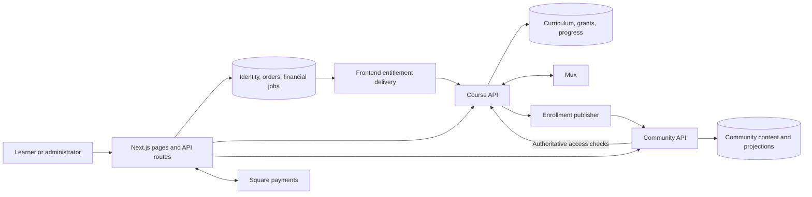

# Unified Course and Community Platform Integration Plan

**November 20 delivery decision — deploy to protected Lightsail staging first.** The APIs are already running. Start from the [live checkpoint](../lash-her-frontend/docs/api-integration/current-state.md#november-20-lightsail-staging-update) and the [active execution queue](../lash-her-frontend/API-INTEGRATION-EXECUTION.md#active-staging-work). Brief staging downtime is acceptable.

1. Take the next item in the protected staging queue, or a higher-priority flow Dardan requests. Fix concrete defects found in the selected flow. Reuse the running release and deploy the changed components in a small update.
2. Verify the staging target and affected bindings, retain the previous compatible release, and use the existing migration procedure if the change requires pending SQL.
3. Smoke-test the changed flow with the protected test account or sandbox provider. Rerun affected checks for any fix and record the result or blocker in the tracker. Use existing CI and deployment output.

Routine protected staging work skips separate certification, broad regression or recovery rehearsals, and evidence packaging. Revisit a release or recovery task when it is a real dependency of the selected change, or when Dardan explicitly prioritizes it. The rest of this plan describes the retained product and launch scope. Production cutover, public customer access, legacy import and scheduled jobs remain held. Both admission gates stay off.

Build one account-based learning platform in `lash-her-frontend`, backed by the Course API for education and access, and the Community API for course-linked discussion.

Current operator decision (October 29, 2026): **Dardan is the sole operator; releases follow the single-operator policy and current checkpoint. Operational monitoring and alerting are deferred until after this integration plan is complete and do not gate the current release.** P1-08 is DEFERRED. Existing readiness, safe diagnostics/audit, capacity tests, recovery and protected release requirements remain. See the [scope decision](../lash-her-frontend/docs/api-integration/decisions/2026-10-29-sole-operator-and-monitoring-deferral.md).

Current affordability decision (November 1, 2026): **Billing access, private cost/spend reports, headroom calculations and verified spending-cap/forecast controls are not prerequisites anywhere in this plan.** Use the lowest practical operating overhead consistent with security, reliability and measured capacity. Dardan manages the US$50 monthly target; it is not a release gate or invoice guarantee. See the [scope decision](../lash-her-frontend/docs/api-integration/decisions/2026-11-01-affordability-without-billing-gates.md).

Current release-policy decision (November 1, 2026): **Use one single-operator release procedure for staging and production.** Dardan explicitly starts each environment release. Use passing CI and the deployment tooling’s existing source, image and migration references. Verify the target, locks, lineage and usable recovery before applying changes. Production promotes the staging-tested builds. External signing keys, identity enrollment, per-run permits, mandatory approval environments/Apps, separate external executors and paid branch-protection upgrades are removed. See the [current policy](../lash-her-frontend/docs/api-integration/release-policy.md).

Current launch-capacity decision (November 10, 2026): **Plan for 50–100 registered users and 5–10 concurrent learners at launch.** Use the launch workload below for P6-03 and G6. Larger stress and recovery profiles are separate, non-blocking growth tests under SCALE-01. See the [capacity decision](../lash-her-frontend/docs/api-integration/decisions/2026-11-10-launch-capacity.md).

The agreed launch scope is:

- Unified free and paid courses, replacing the current Sanity short-course implementation.
- Google and passwordless email-link sign-in.
- Free enrollment with optional, separate marketing consent.
- International paid-course sales by card through Square, charged in CAD in approved markets. Dardan deferred Afterpay from the first paid Course release on November 23, 2026. [P4-08 decision](docs/api-integration/p4-08-production-commerce-preflight.md#payment-scope)
- A versioned tax rate table for approved course markets and classifications, with tax recorded in the purchase ledger.
- Practice and graded quizzes.
- Course communities with profiles, posts, comments, reactions, images, reporting, moderation, and in-app notifications.
- Course authoring and operational tools within the existing frontend `/admin` area.
- Vercel frontend hosting with OIDC-authenticated HTTPS ingress to one AWS Lightsail VPS running the APIs and required workers as separate containers; no Vercel Static IP requirement.
- Self-managed PostgreSQL on the Lightsail instance for each environment, with separate Course, Community, and frontend private databases. Retire Neon after the database cutovers and recovery verification.

## Staging feature order

Use the active execution queue to choose work after the latest protected staging release. Course and Community features can progress independently when their contracts are ready. Paid checkout and payment recovery exercises use isolated Square Sandbox bindings and a synthetic tax rate table.

Record the running revisions and any issue that blocks someone from trying a flow. The detailed scope below defines the finished product. The execution tracker records the current staging work.

Keep the operator-required private API schema baseline in private GHCR storage. Bind it to the exact source revision and CI run and attempt, and verify retrieval by digest.

[Execution tracker](../lash-her-frontend/API-INTEGRATION-EXECUTION.md) · [Integration index](../lash-her-frontend/docs/api-integration/README.md)

The frontend owns the shared tracker. Keep these three copies of the product scope synchronized. Existing P1 completion, G3 acceptance and other prior results remain available as history.

## 1. Community API related work

**Repository:** `/Users/dardan/workspace/lash-her-community-api`

**Ownership:** member profiles, spaces, discussions, moderation, notifications, media processing, and the enrollment projection. The existing API already supplies the enrollment-event receiver, ordered projection, repair, reconciliation, and authoritative Course access-check integration; the member-facing domain must be built.

### Authentication, authorization, and integration contracts

- Accept immutable frontend `customer_users.id` UUIDs as member identities. Verify server-issued, short-lived member and administrator JWTs with the correct credentials, canonical subject, issuer, audience, issue/expiry times, bounded lifetime, and overlapping keys for rotation.
- Enforce the explicit community-moderator capability inside the API; frontend authorization alone is insufficient.
- Retain separate credentials for receiving Course enrollment events and reading Course authority. Continue the existing ordered enrollment projection, repair, and reconciliation integration.
- Handle frontend account suspension, export, and deletion through durable authenticated commands, preserving required audit records. Keep account lifecycle enforcement distinct from community participation suspensions.
- Maintain the Community OpenAPI contract consumed by the frontend's generated, runtime-validated adapter. Application schema changes and migrations remain in the Community repository.

### Community domain, access enforcement, media, and notifications

- Add profiles, one enabled space per course, posts, comments, reactions, reports, moderation actions, notifications, and media-processing jobs.
- Support chronological feeds, cursor pagination, course-scoped search, post editing/deletion, comment threads, and pinned/locked discussions.
- Restrict profiles and member discovery to appropriate shared course spaces. Never expose login email, phone, payment information, or private enrollment history.
- Use enrollment projections for discovery and synchronization. Require the existing online Course authority check for protected content reads, posting, reactions, member access, and media authorization.
- Obtain the protected course ID from the stored resource. Never accept a client-supplied course ID as proof that a post or attachment is accessible.
- Preserve the 1.5-second authority timeout and fail closed when Course is unavailable. A stale positive projection must not override denial.
- Apply community suspensions independently of course enrollment. Moderators can hide/restore content, resolve reports, lock threads, and suspend participation, with required reasons and audit records.
- Use text plus JPEG/PNG/WebP images at launch: maximum five images per post and 10 MB per original image.
- Store originals in a private S3 quarantine area. Verify content, re-encode approved images, strip metadata, and expose only processed assets through short-lived authorized URLs. Run orphan cleanup and deletion asynchronously.
- Provide in-app notifications for replies and moderation outcomes, unread counts, preferences, and read-state updates. Use bounded polling initially.
- Introduce per-principal distributed quotas. Existing IP-based limits must not treat every learner behind the Vercel server as one person.

### Dependencies

- Course owns final access decisions and publishes transactional enrollment transitions for purchases, free enrollments, imports, and administrator changes. Active course enrollment includes access to that course’s enabled community.
- Frontend owns sign-in, token issuance, community screens, and same-origin request handlers.
- Infrastructure deploys the Community API, repair/reconciliation worker, media worker, private S3 storage. Operational monitoring follows after this plan. Category 4 defines deployed feature and recovery checks.

## 2. Course API related work

**Repository:** `/Users/dardan/workspace/lash-her-course-api`

**Ownership:** curriculum, quizzes, grants, learning progress, Mux integration, and final course-access decisions. Extend the existing catalog/curriculum management, entitlement ledger, student content, signed playback, progress, administrator access operations, and reconciliation.

### Authentication, authorization, and integration contracts

- Accept immutable frontend `customer_users.id` UUIDs as learner identities. Verify server-issued, short-lived learner and administrator JWTs with the correct credentials, canonical subject, issuer, audience, issue/expiry times, bounded lifetime, and overlapping keys for rotation.
- Enforce explicit course-editor and course-support capabilities inside the API; frontend authorization alone is insufficient.
- Retain separate credentials for frontend entitlement commands, Course enrollment publication, and Community authority reads.
- Handle frontend account suspension, export, and deletion through durable authenticated commands, preserving required audit records.
- Maintain the Course OpenAPI contract consumed by the frontend's generated, runtime-validated adapter. Application schema changes and migrations remain in the Course repository.

### Catalog and authoring

- Add course covers, SEO metadata, structured lesson content, transcripts, caption references, and course-specific tax classification.
- Preserve the existing Portable Text lesson structure during import, storing a validated, versioned document in Course PostgreSQL.
- Add paginated catalog/admin collections, individual admin course retrieval, transactional curriculum reordering, and optimistic concurrency checks.
- Add lesson/module archival and safe media replacement. Preserve identifiers and historical activity; avoid deleting content referenced by progress or audit records.
- Validate publication: valid slug, supported currency, price/access mode, complete required content, valid quizzes, and ready media.
- Make CAD the launch currency. Existing USD defaults must not silently create purchasable courses.
- Keep existing lifecycle behavior explicit: drafts are hidden; archived courses remain identifiable in learner history but cannot provide active learning content.

### Enrollment and access

- Add authenticated, idempotent free enrollment for published zero-price courses.
- Record free enrollment as an orderless grant with an explicit source. Extend the shared idempotency namespace and ledger constraints; do not fabricate orders or payments.
- Emit Course-to-Community enrollment transitions transactionally for free enrollments, purchases, imports, and administrator changes.
- Preserve existing order-scoped refund revocation and independent manual grants.
- Apply the same effective-access rules to content, playback, quizzes, progress, and Community authority checks, including concurrent revocation and expired grants.

### Quizzes and progress

- Add revisioned quizzes, questions/options, immutable attempts, server-side grading, and derived completion.
- Preserve imported courses as practice mode: a fully answered attempt completes the lesson regardless of score.
- New graded quizzes default to an 80% pass threshold, configurable by editors, with unlimited retries. Retain historical attempts when a quiz changes.
- Prevent generic progress endpoints from marking graded lessons complete without a qualifying attempt.
- Track resume position separately from maximum watched position. Protect against delayed heartbeats overwriting newer progress.
- Keep completion/progress scoped to the authenticated learner. Imported browser progress must never grant access or satisfy graded assessments.

### Video lifecycle

- Complete upload status, retry, replacement, caption, and signed-thumbnail support.
- Verify duplicate and reordered Mux webhooks, failed uploads, deleted assets, and late events for replaced videos.
- Add periodic recovery for stuck processing states and orphaned uploads.
- Preserve the existing 600-second playback-token lifetime. Renew only after rechecking access; existing tokens may remain usable until expiry after revocation.

### Free-course content and media migration

- Build a repeatable dry-run/import process with a durable mapping from Sanity document/module/question keys to Course UUIDs.
- Import titles, slugs, introductions, rich text, quizzes, feedback, images, captions, transcripts, SEO, and video references. Import as free practice courses.
- Transfer media ownership deliberately. Reuse assets only where environment and ownership permit; otherwise import them into the Course-managed Mux environment.
- Verify signed playback before retiring old delivery paths. Existing public media URLs remain public until explicitly retired; changing the application alone cannot make them private.
- Provide the validated practice-progress import support used by the signed-in frontend flow. Imported browser state never establishes identity, grants access, or satisfies a graded assessment.

### Dependencies

- Frontend owns customer identity, free-enrollment UI, authoring UI, payment collection, and payment-to-entitlement delivery. Course handles the corresponding authenticated API operations and access decisions.
- Community consumes Course enrollment events and performs online authority checks. Course’s Community enrollment publisher remains separate from the frontend entitlement outbox.
- Infrastructure deploys the API, enrollment publisher, snapshot worker, migration jobs, and media recovery scheduling. Follow the current single-operator migration policy before production CD.

## 3. Frontend related work

**Repository:** `/Users/dardan/workspace/lash-her-frontend`

**Ownership:** customer identity, orders, payment-provider events, tax records, customer email, payment-to-entitlement delivery, public/learner/community pages, and administration screens. Extend the existing Auth.js administrator login, Square commerce, operational PostgreSQL, and Sanity free-course implementation.

### Customer identity and authorization

- Add frontend PostgreSQL customer accounts, provider links, verification tokens, and customer sessions. Use immutable `customer_users.id` UUIDs across both APIs.
- Implement a customer Auth.js configuration with Google and Resend email links. Keep administrator authentication, cookies, and authorization isolated so adding customer login cannot weaken existing admin access.
- Use database-backed customer sessions, single-use email tokens with a 15-minute lifetime, login throttling, safe return URLs, and generic email-request responses. Auth.js email login requires database persistence. [Auth.js Resend documentation](https://authjs.dev/getting-started/providers/resend)
- Require proof of control before linking another provider to an existing account. Never merge identities from submitted email addresses or course-signup records.
- Require only necessary account information. Preserve existing marketing contact details and consent history without automatically subscribing learners.
- Mint server-only, short-lived API JWTs with separate audiences and credentials for Course learners, Community members, and administrator operations. Require canonical subjects, issuer, audience, issue/expiry times, bounded lifetime, and overlapping verification keys for rotation.
- Retain separate service credentials for frontend entitlement commands, Course enrollment publication, and Community authority reads.
- Map current frontend staff permissions into explicit course-editor, course-support, and community-moderator capabilities. Enforce capabilities inside each API as well as the frontend.
- Add account suspension, session revocation, export, and deletion workflows. Coordinate downstream cleanup through durable authenticated commands while preserving required financial and audit records.

### Frontend pages and service adapters

- Preserve `/courses/[slug]` as the canonical public course URL and add a unified `/courses` catalog.
- Add `/academy` for enrolled courses and continuation, lesson/player routes, `/community` and course discussion routes, and `/account` for identity and preferences.
- Add course, enrollment-support, and community-moderation screens under `/admin`.
- Create server-only Course and Community adapters using generated OpenAPI types and runtime response validation.
- Add explicit same-origin `/api/academy/**` and `/api/community/**` handlers. Do not create an unrestricted proxy to arbitrary upstream paths.
- Authenticate every protected operation, validate input, apply CSRF protection to cookie-authenticated mutations, propagate safe request IDs, and translate API errors into stable UI states.
- Cache public catalog metadata separately. Never share-cache learner content, access decisions, progress, moderation data, or playback tokens.
- Invalidate course catalog caches after successful authoring changes, with a short bounded TTL as recovery.
- Cover loading, empty, pending-access, revoked-access, archived-course, processing-video, unavailable-service, and retry states.
- Reuse the existing design tokens and editorial style. Include keyboard navigation, captions/transcripts, accessible forms, and mobile layouts.

### Square commerce and international tax

- Add a distinct online-course order purpose, customer ownership, immutable course-item snapshots, billing addresses, tax calculations, and entitlement-delivery state.
- Launch with one course per checkout, one-time purchases, and mandatory customer sign-in. Keep product and in-person training fulfillment separate.
- Read price, publication status, and currency from Course server-side. Validate existing ownership before charging.
- Keep Square as the payment processor and charge in the merchant location’s CAD currency. International cards can be accepted subject to Square eligibility; the card issuer handles currency conversion. [Square international development](https://developer.squareup.com/docs/international-development)
- Resolve an approved rate from the versioned tax table by billing destination and course classification. Store the policy version, rate, and tax on the quote, charge the final total through Square, and record sales and refund tax through durable jobs.
- Store the exact quote, line references, jurisdiction, tax treatment, calculation ID, policy version, and customer location evidence with the order.
- Add an explicit international sales-policy configuration containing supported destinations, approved course tax classifications, registrations, and price-display treatment. Unknown or unapproved cases block checkout.
- Store the approved tax treatment for each explicit zero-rate rule. Reject checkout for a destination or classification with no approved rule.
- Include billing-address validation, supported tax-ID validation, appropriate invoice information, and country-specific checkout disclosures.
- Before adding Course Afterpay in a later release, verify production location and course eligibility and enforce server-side limits on the final checkout amount. [Square Afterpay integration](https://developer.squareup.com/docs/web-payments/add-afterpay)
- Extend the existing single Square webhook to handle online-course payments, refunds, and disputes. Validate signatures and provider state before applying financial transitions.
- Grant access only after confirmed completed payment. Never grant from browser success messages or authorization-only states.
- On a fully refunded course item, revoke its purchase grant, including for full-value goodwill. Partial goodwill preserves access unless an explicit audited access-removal action accompanies it. Disputes revoke the affected purchase grant. Verified resolution can issue a new grant command when the purchase remains valid.
- Preserve independent administrator grants and unrelated course purchases.

### Durable entitlement, tax, and receipt delivery

- Write financial state, entitlement commands, tax-recording jobs, and receipt jobs in the same frontend database transaction.
- Deliver entitlement commands through a dedicated frontend outbox with stable idempotency keys, per-order/course ordering, leases, bounded retries, dead-letter handling, and audited replay.
- Use an immediate best-effort delivery attempt plus a protected one-minute recovery cron. A successful purchase must remain recoverable after the request ends.
- Show “payment received, access being prepared” until Course confirms access.
- Run nightly order-to-entitlement reconciliation. Repairs flow through the frontend outbox; administrator overrides are reviewed rather than automatically undone.
- Keep this outbox separate from Course’s existing Community enrollment publisher.

### Free-course frontend migration and compatibility

- Preserve `/courses/[slug]` URLs and update navigation, metadata, sitemap, and course links.
- Provide a signed-in “import progress from this browser” flow. Validate mappings and bound input; import only practice progress. Never infer a customer identity from a browser grant or unverified signup email.
- Allow free re-enrollment when the old cookie or local storage is unavailable.
- Preserve historical marketing consent without generating new consent or subscription changes.
- Keep legacy read compatibility available during a 90-day transition. Retain exports and mappings for recovery; remove obsolete runtime paths after verification.
- Coordinate the final content synchronization and legacy editing freeze with Course import tooling and the release procedure in category 4.

### Launch defaults and boundaries

- English UI, international eligible buyers, CAD charging, one-time course purchases.
- Active course enrollment includes access to that course’s enabled community.
- Marketing is optional and independent of learning access.
- Existing courses remain practice-based; new graded quizzes default to 80%.
- No guest checkout, subscriptions, bundles, certificates, direct messaging, member video uploads, or community email digests in this release.
- Existing bookings, product commerce, and in-person training retain their current ownership and behavior.
- The business owns tax classifications, registrations, destination policies and required disclosures. Engineering applies the owner-approved configuration, including applicable receipt fields, before enabling each market. Checkout blocks cases with missing or unsupported tax treatment.

### Dependencies

- Course must expose validated catalog, authoring, enrollment, content, quiz, progress, playback, and import APIs. Community must expose the protected member and moderation APIs.
- Infrastructure supplies isolated provider configuration, gateway connectivity, scheduled delivery/reconciliation, release flags, and working provider connections. Enable paid checkout only when its delivery and reconciliation jobs are operational.
- Preserve existing bookings, product commerce, in-person training, administrator permissions, marketing consent, and unrelated Sanity content throughout integration.

## 4. Infrastructure / CI/CD / DevOps related work

**Configuration ownership:** shared infrastructure and release coordination in the frontend repository’s operations area; application images and database migrations in each owning repository. This category coordinates the three repositories without transferring application-domain ownership.

### Establish the three-repository baseline

| Area          | Existing implementation                                                                                                                        | Required work                                                                                                            |
| ------------- | ---------------------------------------------------------------------------------------------------------------------------------------------- | ------------------------------------------------------------------------------------------------------------------------ |
| Course API    | Catalog and curriculum management, entitlement ledger, student content, signed Mux playback, progress, admin access operations, reconciliation | Extend content and authoring capabilities; add quizzes, free enrollment, migration support, and authentication hardening |
| Community API | Enrollment-event receiver, ordered projection, repair, reconciliation, authoritative access-check integration                                  | Build the entire member-facing community domain and API                                                                  |
| Frontend      | Auth.js administrator login, Square commerce, operational PostgreSQL, Sanity free courses                                                      | Add customer identity, API adapters, learner/community interfaces, course commerce, and entitlement delivery             |
| Free courses  | Sanity content, public video assets, signed browser access cookies, local-storage progress                                                     | Migrate content and introduce account-based enrollment and server-stored progress                                        |
| CI            | Static checks, tests, migration checks, API container builds, cross-repository contract checks                                                 | Use coordinated builds, integration tests, deployment and rollback                     |
| Operations    | API health/metrics, enrollment runbooks, frontend scheduled jobs                                                                               | Verify recovery and complete backup restoration tooling; monitoring deferred until after this plan                       |

The [Course API contract](../lash-her-course-api/openapi/course-api.json), [Community API overview](../lash-her-community-api/README.md), and [current short-course behavior](../lash-her-frontend/docs/short-courses.md) establish these boundaries.

The [published baseline](../lash-her-frontend/docs/api-integration/baselines/2026-10-04-g0-closure.md) records verified source and original limits. Use the tracker for remaining implementation and release work. Verify changed behavior through the current code and tests.

### Shared deployment and integration architecture

- Keep three independently owned databases. Services communicate through versioned APIs and durable events; they never query another service’s tables.
- Frontend owns identity, orders, payment-provider events, tax records, customer email, and payment-to-entitlement delivery.
- Course owns curriculum, quizzes, grants, learning progress, Mux integration, and final course-access decisions.
- Community owns member profiles, spaces, discussions, moderation, notifications, and its enrollment projection.
- Sanity continues serving unrelated public/editorial content. It ceases to be the authoritative course store after migration.
- Browser application requests use same-origin Next.js endpoints. Explicit exceptions are Square tokenization, authorized Mux uploads/playback, and short-lived object-storage upload/download URLs.

### Lightsail deployment topology and authenticated ingress

**Selected 2026-10-17:** replace the Render topology and Vercel Static IP
requirement with one production AWS Lightsail Linux VPS running separate Docker
Compose containers. Keep the frontend on Vercel. The [October 17 ingress decision](../lash-her-frontend/docs/api-integration/decisions/2026-10-17-lightsail-ingress.md)
defines the security boundary, staging lifecycle, capacity assumptions and
acceptance tests. Current provisioned state and remaining qualification are recorded in the tracker; the topology alone does not establish readiness.

The database migration adds self-managed PostgreSQL to each environment's Lightsail instance. See [migration and Neon retirement](#lightsail-postgresql-migration-and-neon-retirement) for the sequence.

| Process                                | Deployment on the Lightsail VPS                    |
| -------------------------------------- | -------------------------------------------------- |
| Course API                             | Separate private API container                     |
| Course enrollment publisher            | Separate private worker container                  |
| Course snapshot worker                 | Separate private worker container                  |
| Community API                          | Separate private API container                     |
| Community repair/reconciliation worker | Separate private worker container                  |
| Community media worker                 | Separate private worker container when P5-03 lands |
| API ingress                            | HTTPS gateway container with OIDC verification     |
| Metrics collector                      | Deferred until after the current plan              |
| Periodic maintenance and migrations    | Bounded one-shot containers with recorded outcomes |
| PostgreSQL                             | Course, Community, and frontend private databases on persistent storage for each environment |

- Use one production VM for the API stack. Use a separate staging VM on demand,
  recreated from the same configuration with isolated databases, secrets and
  provider settings. Never co-host staging with production. Staging can precede
  production activation; do not require two continuously running VM stacks.
- Keep frontend-owned scheduled delivery and financial recovery on Vercel, using
  the same authenticated gateway path as its server handlers. Preserve ownership,
  database boundaries and existing provider integrations.
- Manage Compose, host bootstrap, gateway policy and release orchestration in the
  frontend operations area. Keep runtime/migration images in their owning repos,
  built in CI and deployed by immutable digest.
- Publish only gateway HTTPS, optional ACME/redirect HTTP, and restricted operator
  SSH. API, worker, internal TLS and metrics ports remain private. Check effective
  Docker/host/Lightsail firewall rules on IPv4 and IPv6.
- Replace Vercel source-IP allowlisting with verified Vercel OIDC workload tokens
  on every frontend-to-gateway call. Validate pinned issuer/JWKS, audience, subject,
  team/project IDs, environment and token times. Use a dedicated workload header
  alongside existing application authorization. Restrict staging to a controlled
  Vercel staging project; never trust arbitrary previews or development tokens.
  OIDC supports custom API verification on all plans. [Vercel OIDC](https://vercel.com/docs/oidc/api)
- Require existing learner/admin/service authorization inside the APIs. Workload
  identity does not establish learner identity, enrollment or administrator rights.
  Allow only explicit methods/routes, including individually listed frontend
  entitlement/reconciliation/lifecycle commands. Keep Course–Community routes and
  metrics absent from public routing; never proxy all internal routes.
- Exempt only the exact Mux webhook POST route from OIDC, preserving raw-body
  signature/timestamp verification and deduplication. Keep Square webhooks at
  the frontend. Deny other hosts/paths and spoofed forwarding/identity headers.
- Preserve private HTTPS with validated CA trust and existing source restrictions
  for actual gateway/private container peers. Verify the receiver's effective
  source and trusted proxy hops; do not allow all addresses or depend on Vercel's
  public egress IPs. Implement TLS/certificate lifecycle in P1-03/P1-04 and account
  for required TLS proxy containers in measured host capacity.
- Bound unauthenticated requests, connections, bodies and JWKS refresh; retain
  per-principal application quotas and separate webhook limits. The gateway is
  internet-reachable and needs bounded quotas, safe rejection diagnostics and fail-closed negative tests. Operational abuse monitoring is deferred.
- Replace the shared 120/minute source-IP application quota with explicit aggregate
  and verified-principal limits. Initial local defaults are 1,200 ordinary requests
  per minute per API process, 120 per verified Course learner/admin profile and
  subject, and a separate 600/minute Mux webhook budget. Keep existing internal
  service quotas independent and health/readiness/metrics outside ordinary traffic
  quotas. Never derive principal keys from unverified JWTs or forwarded headers.
  These defaults require load tuning; local counters do not complete the planned
  distributed quotas. Shared enforcement or reviewed budget division is required
  before API process overlap/scaling. Community member quotas accompany its future
  authentication implementation.
- Require Community framework throttling to return HTTP 429 with its safe error
  envelope and applicable Retry-After headers; unexpected errors remain sanitized
  500s. P1-03 must test the real limiter/error handler and deployed gateway
  propagation; clients must honor retry timing and idempotency.
- **ENV-02-01 accepted 2026-10-17:** use the dedicated staging Vercel project's
  Production target with server-only `APP_ENV=staging` and `staging.lashher.com`;
  retain the production project's Production target with `APP_ENV=production`
  and `lashher.com`. Keep a separate staging VM and exact project/team/OIDC claim
  bindings. Both targets have OIDC `environment=production`; that claim alone
  cannot distinguish the environments. P1-02 must inventory actual IDs, provider
  resources and domain assignments. Implement a validated project/business-
  environment mapping and update Sanity/shipping guards before deployment. The
  [audit follow-up](../lash-her-frontend/docs/api-integration/decisions/2026-10-17-audit-remediation.md)
  records the accepted arrangement and outstanding implementation. P1-07 requires
  deterministic scheduled-handler tests and a working scheduler,
  and safe suspension/recovery when staging compute is deleted/recreated.
- Isolate OAuth callbacks, Mux, Square, tax policy, storage, notifications and all
  credentials by environment/service. Budget PostgreSQL connections across Vercel, APIs and workers. Use distinct runtime and migration roles for each database.
- Set per-container resource limits, restart/readiness/heartbeat behavior, log
  rotation and bounded media concurrency. Check host capacity and burst balance against the launch workload.
  A single VM is a shared outage/compromise boundary; retain patch ownership and
  a rehearsed replacement-host recovery procedure. Operational monitoring and alerts are deferred.
- Start sizing tests at the Lightsail 2-vCPU/4-GB Linux public-IPv4 candidate;
  increase only if measured load, media processing or deployment overlap requires it.
  Prefer the smallest adequate bundle, reuse existing databases/providers, keep
  staging temporary and clean up disposable resources through approved teardown.
  No paid static-egress, load-balancer or NAT-gateway dependency is introduced.

### CI requirements

Retain existing checks and add:

- Node.js 24 and reproducible npm versions across local development, Actions, and containers.
- Passing CI on every deployable branch, including frontend staging. Verify exact reviewed commits and current successful CI before candidate publication. Use available native branch/check protection.
- Type checking, lint, unit tests, dependency scanning, OpenAPI drift checks, and generated-client drift checks.
- PostgreSQL 16 integration tests, clean-install migrations, data-bearing upgrade tests, schema drift, and safe migration rollback tests. Exercise the operator migration CLI on isolated databases matching the release targets.
- Container startup/readiness tests for every process, not just image builds or entrypoint existence.
- A cross-repository integration suite that starts all three applications, the gateway and required workers against isolated databases, exercising the selected TLS and authentication boundaries.
- Use CI and deployment metadata to identify the tested commits, images, contracts and migrations. The operator explicitly starts deployment.
- Candidate-versus-released contract compatibility tests. Use explicitly pinned revisions rather than assuming another repository’s moving `main` is compatible.
- One narrowly scoped read-only cross-repository credential where needed; a fine-grained token is sufficient and an App is optional. Keep deployment and migration credentials separate from CI source access. Retain immutable images, automatic scans, SBOMs and native provenance.

### Lightsail PostgreSQL migration and Neon retirement

- **Staging in P6-00.** Course and Community already use PostgreSQL on staging Lightsail. Move the existing frontend private database, including transaction and operational history, onto that staging instance. Rehearse data transfer, writer drain and rollback before the reviewed staging switch. Verify real Vercel server routes and scheduled callers through an authenticated, TLS-verified path to the private DB. Keep PostgreSQL listeners private and verify that the database ports are unreachable directly over public IPv4 and IPv6. [Staging checkpoint](../lash-her-frontend/docs/api-integration/current-state.md) · [Lightsail firewall reference](https://docs.aws.amazon.com/lightsail/latest/userguide/understanding-firewall-and-port-mappings-in-amazon-lightsail.html)
- **Production setup and rehearsal in P6-00.** Provision persistent storage and isolated Course, Community, and frontend private databases on the production Lightsail instance. Measure capacity with the APIs, workers and PostgreSQL sharing the host. Pin the source and target bindings, check PostgreSQL version and extensions, and rehearse copying existing data, preserving migration journals, applying any pending SQL, switching bindings and recovering from an interrupted cutover. Prove encrypted off-host backup and point-in-time recovery against the existing recovery objectives. [PostgreSQL recovery reference](https://www.postgresql.org/docs/current/continuous-archiving.html)
- **Production switch in P6-06.** After G6 and explicit production approval, fence and drain affected writers on the source databases, including historical Vercel deployments, callbacks, schedules and workers. Preserve payment intake and reconcile in-flight work through the switch. Finish the data sync, verify data and journals, and switch the Vercel, API and worker bindings to Lightsail. Verify transaction and refund recovery, enrollment and Community access state, and exact environment bindings before restoring eligible writers. Switch back to a source database only after accounting for any writes accepted on Lightsail.
- **Neon retirement in POST-03.** Keep the source databases protected during the reviewed rollback period. After both environments are stable and Lightsail recovery is verified, confirm that runtime, migration, recovery, CI and retained deployment paths have no Neon dependency. Remove Neon bindings and integrations, revoke legacy access, and retire the remaining Neon resources after required backups and retention are accounted for.

### CD and promotion

Follow the [routine staging sequence](../lash-her-frontend/docs/api-integration/release-policy.md#staging-review-release-verify) for protected feature updates. The release paths below apply to their own operations. P1-09 covers final admission and producer restoration. P2-00 applies when an approved change requires pending frontend SQL on a shared database. P6-00 precedes production G6/P6-06. Each path retains its own safety and recovery checks.

1. Publish verified API images to GHCR by immutable digest.
2. Build separate migration images containing migration files and tooling; current runtime images do not contain the complete migration toolchain.
3. Use the existing isolated Lightsail staging stack, Compose configuration and pinned deployment inputs.
4. Run each database’s migration image once through the operator release command, holding environment/database locks across target/lineage preflight, apply and verification, before dependent code.
5. Deploy compatible receiver/read APIs, workers, frontend, and feature flags in dependency order.
6. Smoke-test the changed staging flow. Run additional browser, provider, boundary, or recovery checks when the change affects them.
7. Explicitly promote the staging-tested API/worker/gateway/migration digests to production with production target and current backup confirmation in the same operator release command; reserve measured update headroom or use a documented maintenance window.
8. Build the frontend with production configuration as a staged production deployment; test it before assigning production domains. Do not promote a staging-configured build as though its configuration were interchangeable. [Vercel deployment promotion](https://vercel.com/docs/deployments/promoting-a-deployment)

Keep the previous deployable versions and configuration accessible for rollback and VM recreation. Protect host deployment credentials and verify readiness before routing traffic; a single VM does not guarantee zero-downtime updates.

Follow the [single-operator migration policy](../lash-her-frontend/docs/api-integration/migration-policy.md), which supersedes P0-02’s former external signed-executor procedure. Implement/test one reviewed operator-invoked entrypoint with artifact, target, lineage, locking, staging and recovery checks. It may run on Dardan’s authenticated Mac or the deployment host; no separately hosted executor or extra signature is required. Direct/ad hoc production migration, application-startup migration, tests, seeds and destructive round trips remain prohibited. Policy simplification does not activate a live migration path.

### Monitoring and recovery

Operational monitoring and alerting are deferred by the October 29 sole-operator decision until after the current integration plan is complete. They do not gate G1 or the current release. Keep the prepared collector/exporter and alert definitions inactive; choose the off-host service, recipient and delivery tests in the later follow-up.

Deferred monitoring work:

- Scrape each API and worker privately. Track availability, latency, connection saturation, worker heartbeats, queue age, retries, dead letters, reconciliation drift, playback denial, media failures, tax-recording backlog, host RAM/CPU/burst/disk and certificate expiry.
- Establish off-host alerts/logs, complete-host-loss checks and authorized operator delivery for worker, authorization, queue and provider failures.

Current recovery and diagnostics work:

- Preserve safe correlation IDs across frontend, APIs, jobs and provider events. Exclude tokens, raw identities, payment details and private content from logs and metric labels.
- Verify payment-to-course access P95 under 60 seconds and P99 under five minutes, with equivalent Course-to-Community propagation targets, in the applicable acceptance or load tests.
- Complete the real backup/restore runner; the frontend backup-validation endpoint is a scaffold.
- Require point-in-time recovery, encrypted backups and a successful isolated restore of all three databases. Initial recovery targets: RPO at most 15 minutes and RTO at most four hours.
- Document secret rotation, payment-without-access recovery, disputed/refunded orders, Mux failures, moderation incidents, worker restart, host patching/recreation, certificate renewal, restore and application rollback. Rehearse VM loss and lease/job resumption; host snapshots do not replace database PITR.

### Growth beyond one Lightsail VPS

Lightsail is the selected launch compute platform. If measured capacity or
availability needs exceed one VM, retain this separately scoped expansion path:

- OCI images and explicit process commands → ECS/Fargate services and tasks.
- GHCR artifacts → ECR without rebuilding application logic.
- PostgreSQL → RDS through a separately rehearsed data migration.
- Per-service protected secret delivery → Secrets Manager integration; deployment authentication → GitHub OIDC where supported.
- Scheduled jobs → EventBridge-triggered tasks.
- Gateway/private networking → AWS load balancers, security groups, and private subnets.
- S3 media remains in place.

Scale compute first and migrate databases only through a separately rehearsed decision. ECS/Fargate, RDS, managed load balancers and NAT gateways are not launch prerequisites. Avoid introducing Kubernetes or new service-specific queues for the initial release.

### Cross-repository delivery sequence

Use the phases to group work and run shared feature checks. Start integration from the existing contracts and adapter code. Use P2-00 when an environment needs pending frontend SQL. Course authority and identity are the Community dependencies. Gather commercial policy and check initial Afterpay feasibility while feature development proceeds.

| Phase                             | Deliverable                                                                                                                    | Working result                                                              |
| --------------------------------- | ------------------------------------------------------------------------------------------------------------------------------ | ---------------------------------------------------------------------- |
| 0. Establish baseline             | Inventory deployed versions/data, preserve ongoing changes, reconcile stale documentation, commit and pin enrollment contracts | Reproducible three-repository baseline                                 |
| 1. Platform and contracts         | Lightsail staging containers, databases, OIDC gateway, CI/CD, generated clients, readiness and diagnostics                     | Authenticated cross-service smoke tests and blocked unauthorized paths |
| 2. Identity and Course completion | Customer accounts, free enrollment, authoring, quizzes, media lifecycle, learner UI                                            | Complete account-to-learning flow                                      |
| 3. Free-course migration          | Content import, media transition, legacy progress import, URL preservation                                                     | Reconciled content and learner acceptance                              |
| 4. Paid courses                   | Square checkout, tax rate tables, financial jobs, entitlement delivery, support tools                                         | Purchase, refund, dispute and recovery work                         |
| 5. Community                      | Course spaces, discussions, images, moderation, notifications                                                                  | Enrollment and revocation enforced throughout                          |
| 6. Production readiness and rollout | Staging private DB switch, production Lightsail PostgreSQL setup and rehearsal, load and recovery checks, production cutover | All three database owners use Lightsail in both environments |

### Migration cutover, feature flags, and rollback

- Freeze legacy course editing for the final synchronization, compare counts and content hashes, and switch authoring to the frontend admin.
- Coordinate Course-owned import/media verification with frontend-owned URL, browser-progress, consent, and 90-day compatibility work. Retain exports and mappings for recovery and require verified signed playback before retiring public media paths.

Roll out using independent flags for customer access, Course-backed reads, checkout, entitlement recovery, community reads, and community writes. Enable paid checkout only when its delivery and reconciliation jobs are operational.

On rollback, stop new affected writes or sales first. Keep verified-payment reconciliation, refund processing, and safe recovery active unless those components caused the incident. Restore compatible application images without reversing audit-bearing migrations. Never restore an older database as a routine application rollback.

### Feature and release checks

| Area                | Implementation owner                                 | Behavior to test                                                                                                                                                          |
| ------------------- | ---------------------------------------------------- | -------------------------------------------------------------------------------------------------------------------------------------------------------------------------- |
| Identity            | Frontend; both APIs for access enforcement           | Google/email login, expired/reused links, account linking, session revocation, customer/admin isolation, cross-account access denial                                       |
| Course authoring    | Course API; frontend admin UI                        | Draft/published/archive behavior, ordering conflicts, revision changes, content sanitization, upload failure/replacement, accessibility                                    |
| Learning            | Course API; frontend learner UI                      | Free enrollment, paid access, preview rules, server grading, retries, cross-device resume, legacy import, revoked/expired access                                           |
| Commerce and tax    | Frontend                                             | International billing addresses, supported/blocked markets, tax-inclusive/exclusive displays, invalid tax IDs, stale quotes, CAD rounding, Afterpay eligibility            |
| Financial recovery  | Frontend; Course API for grant/revocation outcomes   | Duplicate/reordered webhooks, payment timeouts, capture followed by crash, refund-before-grant delivery, disputes, tax-job failure, replay conflicts                       |
| Community           | Community API; frontend community UI                 | Course isolation, delayed enrollment projection, authoritative denial, Course outages, moderation bans, image authorization, upload validation, notification deduplication |
| Distributed systems | All application owners | Worker termination, lease recovery, concurrent consumers, dead letters, snapshot expiry, missed events, drift repair, key rotation                                         |
| Deployment          | Infrastructure/CI/CD/DevOps; each database owner     | Migration from current data, Compose readiness, OIDC/route restrictions, environment isolation, compatible rollback, host recreation and database restore                  |
| Regression          | Frontend                                             | Existing product checkout, bookings, in-person training, admin permissions, marketing consent, and unrelated Sanity content                                                |

Use the [task briefs](../lash-her-frontend/docs/api-integration/briefs/README.md) for decisions that affect the code or how it must behave. Resolve the relevant inputs and test these cases in the affected feature:

- P2 identity/lifecycle: define outstanding-token/in-flight denial and outage recovery, export expiry and record-specific retention. Preserve v1 command ordering/tombstones and the 300-second user-token/30-second skew limits; existing video tokens may last 600 seconds. Frontend session revocation alone is not immediate downstream revocation.
- P2/P3 learning/migration: define versioned content/quiz/progress/media mappings and repeatable import and hash checks. Record archive consequences for existing paid learners/history/community and support/refunds before paid publication; retain the existing archive access rule unless explicitly amended.
- P4 commerce: specify quote version/expiry, concurrent purchase prevention, uncertain capture recovery and completed/refund/dispute ordering. Assign distinct semantic regrant commands after verified dispute resolution. Financial state and entitlement/tax/receipt jobs stay atomic and independently idempotent. Resolve Afterpay feasibility before a later release includes that method. Tax, legal and retention inputs are business supplied.
- P5 media: supplement five images/10 MB compressed limits with measured decoded dimensions/pixels, CPU/memory/time/concurrency, queue/storage admission, upload finalization/ownership, orphan retention and signed-URL lifetime/revocation behavior before uploads are enabled.
- P1-09/P2-00/P4/P6 release/recovery: define bounded stop of new work even when redeployment is unavailable, including historical deployment URLs, while preserving safe financial recovery and admitted work. Environment rollout flags alone do not prove immediate writer suspension.
- P6 restore: define authority, restore/replay order/horizons/watermarks and tombstone/stream-version recovery across all three DBs, including acknowledged downstream work lost by restore and frontend history behind actual provider payments. Independent database restores alone do not establish platform consistency.
- P4-07/P5-07/P6-03 measurements: define clock origins/endpoints, sample sizes, pending/error denominators, workload mix and degraded/catch-up behavior. Measure authoritative completed-payment-to-usable-access separately from webhook-receipt-to-ack; measure committed Course transition-to-Community projection. Both propagation targets remain P95 <60 seconds and P99 <5 minutes. Apply the launch reconciliation/recovery envelope below; define a separate time/resource envelope before any larger SCALE-01 run.

### Launch workload and capacity acceptance

The launch planning baseline is **50–100 registered users and 5–10 concurrent learners**. Registration count does not establish a paid/free enrollment split, average traffic or recurring subscribers; subscriptions remain outside launch scope. The remaining figures are conservative test allowances, not measured demand, sales forecasts, application quotas or resource-provisioning instructions.

| Dimension | Launch qualification requirement |
| --- | --- |
| Registered population | 50–100 distinct customer accounts in isolated fixtures. |
| Interactive learning | A 30-minute run: 15 minutes at 5 concurrent learners, then 15 minutes at 10. Include realistic navigation, playback authorization/renewal, progress and quiz activity. |
| Community activity | 1 concurrent writer in the first stage and 3 in the second, within the learner population rather than additional users. Include reads, posts/comments/reactions, notification polling and the permitted image workload. |
| Enrollment propagation | 1 unique effective access-change event/minute, increasing to 10/minute for a five-minute burst during the 10-learner stage, then returning to 1/minute. Count delivery attempts/retries separately. |
| Full reconciliation | At least 1,000 customer–course streams, or the full release/import population if larger. Include active, revoked and historical states; complete a full pass within five minutes while 10 learners and 3 writers remain active. |
| Backlog recovery | A separate drill with 100 unique queued enrollment events plus duplicate/retry attempts; drain and verify the resulting projections within five minutes after dependencies are healthy and recovery workers are admitted, with 10 learners and 3 writers active. |

The Community allowance models roughly one writer per four active learners, rounded up to three at the upper stage. The stream fixture allows up to ten customer–course pairs per account at the upper registered population; it does not assume ten purchases per learner. Size real reconciliation to the complete retained population, including imported history, and reassess affected qualification if it exceeds this baseline. The enrollment rates model occasional transitions plus a short enrollment/import burst, not routine browsing or video traffic.

Use the load runner output to check latency, event completion and host saturation. Preserve authorization, ordering and idempotency under normal load and injected failures. Verify final state and keep the payment-to-access and Course-to-Community P95/P99 objectives. Measure recovery catch-up separately from normal propagation latency.

Launch still requires termination/lease recovery, concurrent consumers, dead letters, snapshot expiry, missed-event/drift repair, key rotation and outage behavior at this scale, plus the P6-04 three-database restore and rollback checks and existing RPO ≤15 minutes/RTO ≤4 hours. Tune rate limits against measured traffic without weakening authorization; these lower workload targets do not change configured quotas.

### Larger stress and recovery tests

Retain **100 concurrent learners, 25 concurrent Community writers, 600 enrollment events/minute and one million reconciled streams** as the separate SCALE-01 growth/stress profile. Larger backlogs, long outages and asymmetric recovery at that population belong to this profile. These tests may run in isolation before or after launch, but are **not prerequisites for P6-03, G6, production activation or completion of the launch integration plan**. Existing large-profile CI results are component benchmarks, not proof of the launch browser/provider/recovery flow.

Before a SCALE-01 run, define its request/media mix, concurrency overlap, duration, backlog/outage population, completion/latency/resource envelope and safe isolated targets. Use the growth tests to assess expansion beyond the launch baseline. The existing 300-events/minute planning assumption and twice-rate certification in older enrollment runbooks no longer define launch demand or admission.

### Provider testing

Complete real staging exercises for Google, Resend, Mux, and Square Sandbox. Verify tax quotes and reversals with the versioned staging table and verify production Afterpay eligibility separately. Mocked browser tests provide local evidence. Provider readiness requires staging runs.

Fix and rerun failed provider and recovery flows before enabling the affected production behavior.
