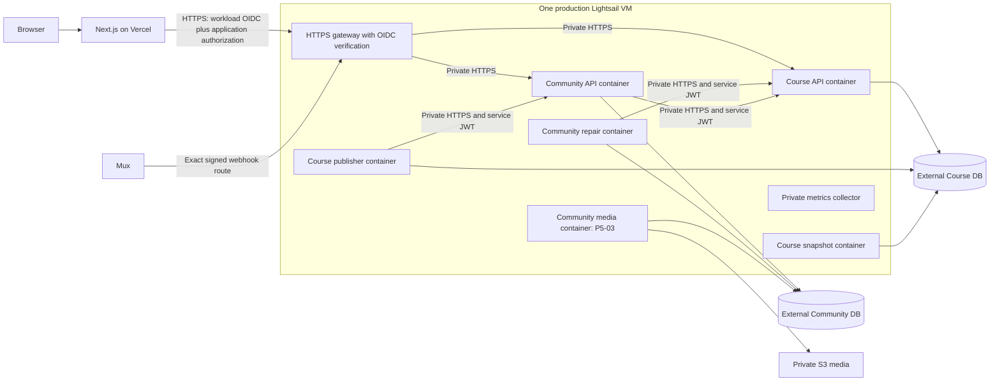

# ENV-01e — Lightsail containers and authenticated ingress

Recorded 2026-10-17, America/Toronto. Decision owner: Dardan. Delivery: OPS,
with FE, COURSE and COMMUNITY. Status: selected planning baseline; implementation
and deployed verification remain outstanding in P1-02–P1-08 and P6.

Dardan explicitly directed removal of the Vercel Static IP requirement and
consolidation of the APIs and required workers on one AWS Lightsail VPS as
separate containers. This document selects OIDC-authenticated HTTPS ingress to
implement that direction. It supersedes the Render topology and pending provider
alternatives in ENV-01a–ENV-01d. Retaining the frontend on Vercel and the existing
database providers preserves the rest of the agreed scope. No resources were
provisioned and no deployed security control was changed by this decision.

## Deployment and environment boundaries

- Run one production Lightsail Linux VM with Docker Engine and Compose. Use a
  public-IPv4 bundle and an attached Lightsail static address for gateway DNS.
  This is the server's ingress address, not a Vercel outbound-IP dependency.
- Run separate containers for Course API, Course enrollment publisher, Course
  snapshot worker, Community API, Community repair/reconciliation worker, HTTPS
  ingress gateway and private metrics collector. Add the separate Community
  media worker when P5-03 is ready. Bounded maintenance and migration jobs use
  separate one-shot containers from their owning repositories.
- Keep frontend pages, same-origin handlers, Square/provider webhooks and
  frontend-owned scheduled financial delivery on Vercel. Add workload identity
  to its backend adapters and scheduled calls. Do not move financial ownership
  into either API or replace the existing frontend schedules as part of this change.
- Keep the three independently owned PostgreSQL databases with their current
  providers. Preserve separate runtime/migration credentials and staging targets.
  S3 media remains private and external to the VM. No database-provider migration
  or self-hosted production PostgreSQL is included.
- Use a separate, reproducible Lightsail staging VM during integration/release
  testing, with its own database targets, secrets, buckets, DNS and certificates.
  Do not place staging containers or unreviewed preview code on the production
  host. Start with staging, activate production at cutover, and recreate staging
  on demand after launch. Destroying staging compute must not delete retained
  evidence, required backups or durable data. Stopped Lightsail VMs remain billed;
  account for retained snapshots/addresses when compute is deleted.
  [Lightsail billing](https://docs.aws.amazon.com/lightsail/latest/userguide/amazon-lightsail-frequently-asked-questions-faq-billing-and-account-management.html)
- Compose configuration, gateway policy, host bootstrap and release orchestration
  belong in the frontend operations area; application and migration images remain
  owned by their repositories. Build in CI, publish to GHCR, pin by digest and
  deploy a reviewed release manifest. No production image builds or automatic
  image-updater deployments.

## Gateway authentication

Use a small HTTPS reverse-proxy container with OIDC-verification middleware.
It is part of the VM's compute budget. There is no Vercel Static IP add-on, paid
API gateway, load balancer or NAT gateway in this baseline. The gateway is
internet-reachable: workload authentication replaces the external source-IP
allowlist, while the application containers remain unpublished.

1. The Next.js server obtains its current Vercel workload token through the
   supported OIDC SDK for each outbound call. Send it in a dedicated
   `X-Lash-Workload-Token` header; preserve `Authorization` for the existing
   learner/admin/service JWT where the route requires it. These headers are the
   selected gateway contract, not implemented configuration. Build outbound
   headers explicitly; never relay browser-supplied credentials as workload proof
   or expose tokens to the browser, URLs, logs or caches. Do not cache a build-time
   token for runtime traffic. Vercel documents two-hour Function tokens reused
   for up to 90 minutes, so they are reusable bearer credentials, not per-request
   signatures. [Vercel OIDC runtime lifecycle](https://vercel.com/docs/oidc)
2. Verify signatures with the configured team's HTTPS JWKS endpoint and an
   explicit algorithm policy. Validate exact `iss`, `aud`, `sub`, `owner_id`,
   `project_id`, `environment`, and required `iat`/`nbf`/`exp` with bounded clock
   skew and lifetime. Pin issuer/JWKS configuration; never fetch keys from a URL
   supplied in the token. Cache public keys with bounded refresh/timeouts and
   rotation support; unknown keys or unverifiable tokens fail closed. No shared
   secret, Origin header or source-IP fallback bypasses this check.
   [Vercel own-API verification](https://vercel.com/docs/oidc/api),
   [OIDC claims reference](https://vercel.com/docs/oidc/reference)
3. Production accepts only its explicitly configured production project/target.
   Staging uses a dedicated Vercel staging project with controlled deploy access
   and `staging.lashher.com`, bound to its own exact project/environment claims.
   ENV-02-01 selects each project's Production target; both OIDC environment
   claims are `production`, so exact project bindings distinguish the two.
   A separately validated `APP_ENV=staging`/`production` mapping must govern
   business providers and preserve production safeguards before deployment. An
   `environment: preview` claim alone does not identify a branch or approved
   deployment. Do not authorize arbitrary PR previews, development tokens or
   every project in the team. Untrusted previews receive no integration signing
   keys. Record actual IDs/claims in P1-02 and test isolation in P1-03.
4. Workload identity establishes the calling application only. The target API
   must still validate its existing user/admin/service credential and enforce
   scopes, capabilities, enrollment, idempotency and account state. Public catalog
   routes need workload authentication at the gateway but do not acquire a new
   learner-login requirement. OIDC cannot replace user or service authorization.
5. Remove workload tokens after gateway verification, before forwarding. Reject
   duplicate/ambiguous auth headers and strip caller-supplied identity/forwarding
   headers. The gateway uses a fixed upstream map and never forwards credentials
   to caller-selected hosts or follows cross-origin redirects.

OIDC is documented as available on all Vercel plans; it removes the paid static
egress requirement. The Vercel subscription and ordinary usage costs remain.
[Vercel OIDC availability](https://vercel.com/docs/oidc/api)

## Route, network and abuse controls

| Traffic | Permitted boundary |
| --- | --- |
| Frontend catalog, learner/member and administrator requests | Exact method/path allowlist; OIDC first, then route-specific application authorization |
| Frontend entitlement, reconciliation and account-lifecycle commands | Individually allowlisted contract routes with OIDC plus their dedicated service JWT; never proxy all of `/v1/internal/*` |
| Mux events | Only the exact Course webhook POST route bypasses OIDC; preserve raw body and verify Mux signature/timestamp and event deduplication in Course |
| Course publication, Community authority reads and repair/snapshot traffic | Private Compose network and HTTPS with existing distinct service credentials; absent from the public gateway route map |
| API/worker health, metrics and management | Private listeners/collector only; restricted operator access, no public diagnostic bypass |
| Every other host, method or path | Deny by default, including ambiguous encodings and alternate-origin access |

- Publish only gateway HTTPS on port 443. Port 80, if used, serves only ACME
  validation/HTTPS redirect. Restrict SSH to approved operator access; apply both
  Lightsail and host firewall rules for IPv4 and IPv6. API, worker, collector and
  internal TLS ports have no host publications. Verify Docker's effective rules;
  UFW alone is insufficient because Docker can route published traffic before
  UFW processing. Do not attach application containers to the Docker socket or
  use host networking/privileged mode.
  [Docker firewall behavior](https://docs.docker.com/engine/network/packet-filtering-firewalls/)
- Use scoped container networks and fixed, reviewed peer assignments. Preserve
  private HTTPS and CA verification on gateway-to-API and inter-service calls;
  implement native TLS or private TLS proxies in P1-03/P1-04, budgeting any extra
  containers, with certificate
  renewal, expiry alerts and trust rotation. Never disable TLS validation merely
  because containers share a host. Allow controlled outbound access for databases,
  providers and JWKS; do not accidentally isolate workers from required dependencies.
- Existing API production source checks still apply to private peers. Configure
  `INTERNAL_SERVICE_ALLOWED_IPS`, `COURSE_COMMUNITY_READ_ALLOWED_IPS` and
  `COURSE_PUBLISHER_ALLOWED_IPS` for the actual gateway/authorized private peers,
  not Vercel public egress or all addresses. Keep proxy trust disabled where a
  direct peer suffices; if a TLS proxy is used, trust only its exact private hop
  and set verified forwarding metadata. In particular, do not pass the public
  Vercel address into `request.ip` for an internal peer allowlist. Prove the
  effective source at each receiver, including after container recreation.
- Set pre-authentication connection/request/header/body limits, timeouts and
  bounded JWKS refresh. Apply post-authentication per-principal/route quotas.
  Preserve separate webhook limits and raw-body handling. Count auth failures
  without logging credentials. CORS, an Origin/Host match and a secret URL are
  not authentication. Internet reachability leaves denial-of-service risk;
  record a response/escalation runbook and measure rejection-path capacity.

### Audit follow-up requirements

The [2026-10-17 audit follow-up](2026-10-17-audit-remediation.md) specifies the
authorized rate-limit correction and mandatory Community 429 behavior. Ordinary
HTTP traffic uses an explicit aggregate budget, with verified-principal quotas
after application authentication; never use the gateway's private peer address
as a learner/member identity. Keep service/webhook budgets and operational probes
independent. Local defaults (1,200 ordinary requests/minute/API, 120 per Course
principal/profile, 600 Mux events/minute) require load tuning and do not establish
distributed enforcement or deployed capacity.

P1-03 must prove genuine 429 responses with safe envelopes and Retry-After through
the limiter, error handler and gateway, while unknown errors remain safe 500s.
P1-02 must inventory the accepted staging target/business-environment mapping,
and P1-07 must verify scheduled execution plus safe staging suspension/recreation.
The follow-up's dedicated-project Production target and APP_ENV separation were
accepted by Dardan as ENV-02-01 on 2026-10-17. The frontend resolver/guards and
actual project/provider bindings remain implementation and verification work.

## Single-host operations, capacity and cost

Containers isolate processes and releases, not host outages or root compromise.
A VM failure interrupts both APIs and all co-located workers. Use per-container
CPU/memory/PID limits, bounded media concurrency, rotating logs, disk alerts,
restart policies, application readiness and worker heartbeats. Define recovery
for unhealthy-but-running containers; a restart policy alone only handles process
exits. Collect host RAM/CPU/disk and Lightsail burst-capacity metrics. Send alerts
and safe logs off-host, and use an external availability/heartbeat check so total
host loss remains visible when the collector also stops.

Start capacity tests with the Linux public-IPv4 2-vCPU/4-GB bundle, listed at
**US$24/month** on 2026-10-17. The 2-vCPU/8-GB bundle is **US$44/month**. These are
candidate sizes, not certified capacity or an approved total budget. Measure all
containers, media bursts and deployment overlap; retain the existing P6-03 load
targets. Include temporary staging, snapshots, transfer overages, database/PITR,
monitoring, Vercel and application-provider charges. Snapshot pricing is separately
listed at US$0.05/GB-month. [Lightsail pricing](https://aws.amazon.com/lightsail/pricing/)

OPS owns OS/Docker patching, restricted administrative access, certificates,
deployment credentials, secret delivery and VM recreation. Keep secrets out of
Compose/Git/image layers; deliver per-service secrets from protected stores as
restricted files/environment, with encrypted recovery material off-host. Store
bootstrap, release manifests and immutable image references outside the host.
Rehearse rebuilding a replacement VM, restoring certificates/configuration,
reattaching the address, resuming leases/jobs and validating access. Server
snapshots do not replace database PITR: retain isolated three-database restores,
RPO at most 15 minutes and RTO at most four hours. No high-availability claim or
zero-downtime deployment guarantee follows from this design.

## Execution mapping and acceptance

| Gate | Required evidence |
| --- | --- |
| P1-02 | AWS account/access, region and instance bundle; staging lifecycle; Vercel project/claim mapping; domains/CA/operator; three database targets and connection budgets; itemized costs |
| P1-03 | Authorized OIDC calls succeed without stable Vercel egress. Missing/forged/expired/future tokens, wrong issuer/audience/team/project/environment, application-token-only calls and OIDC-only protected calls fail. Exercise key rotation/JWKS outage, untrusted previews, spoofed/duplicate headers, direct IPv4/IPv6 ports and alternate paths/hosts. Only correctly signed Mux events enter the exception |
| P1-04 | Every current process starts, reports readiness and shuts down safely under Compose; aggregate pools, limits, worker leases/retries and migration artifacts verified; provision media wiring for P5-03 |
| P1-05/P1-06 | CI image/contract checks and pinned cross-repository harness include the gateway and actual TLS/proxy/auth boundaries |
| P1-07 | Recreate isolated staging from a manifest; protected, locked one-shot migration jobs precede dependent containers; deploy by digest and roll back compatible images; frontend server-request and scheduled smoke contexts both authenticate; feature adapters/delivery reuse this transport in P2/P4 |
| P1-08 | Private scraping, host/worker alerts, certificate expiry and external host-loss alert reach the operator |
| P6-02–P6-05 | Repeat deployed boundary tests; certify load, host loss/recreation, lease recovery, database restore and rollback; record measured costs and operational ownership |

P1-02 remains blocked on resource/account inputs; P1-03 and later infrastructure
tasks remain unstarted. Selecting this design does not claim deployment, provider
eligibility, budget approval, completed gates or production-migration authority.
The protected release-job migration policy continues to apply.
